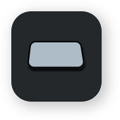

# Min - New Tab for Bookmarks

Min is a minimal new tab page for Chrome bookmark.

Search, open, and organize your bookmark in a minimal new tab page.

## Features

### Bookmark management

- View bookmark by folder
- Add, edit, delete, and reorder bookmark

### Quick access

- Search bookmark and the web
- Navigate with the keyboard

### Display settings

- Customize date and time display
- Adjust theme, font, and bookmark icon display
